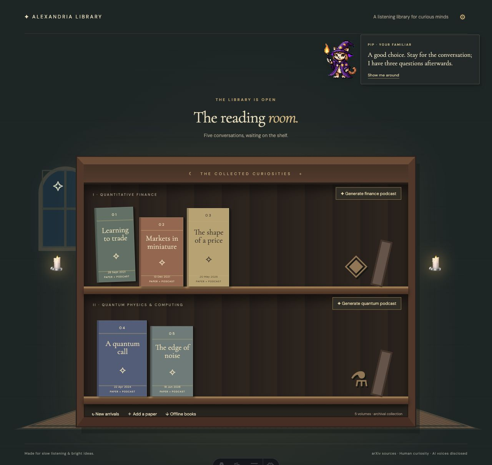
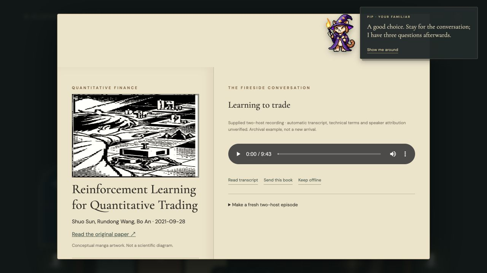

# Alexandria Library

**Project name + description:**

We are expected to learn at the speed of AI. Every day brings another paper, another breakthrough, another piece of documentation we are told to read to keep up.

But what happens when reading quickly is not how your mind works? For a dyslexic or neurodivergent learner, the distance between curiosity and comprehension can feel unnecessarily wide. Why should a wall of text be the one-size-fits-all gateway to discovery?

**Alexandria Library** is a listening library for curious minds who want another way in. It brings research into a welcoming bookshelf, with conversational podcasts, transcripts, visual stories and small questions to help ideas stick. Its goal is to turn recent arXiv research into engaging audio so your inner scientist can stay connected to new papers and discoveries at a pace that works for you. Along the way, Pip, your wizard-cat librarian, guides you around the shelf, keeps you company as you listen, and offers questions to help you reflect on what you’ve learned.

The vision is to help you judge whether a paper is credible and relevant to you. Today, the app’s own Decision endpoint adapts explanation style using your feedback; it does **not** yet assess scientific credibility. Recent-paper refresh and new podcast generation require the cloud services described below.

## A look inside

These screenshots show the current local development preview; some ongoing changes may not yet be included in the published code.

- [x] **Public GitHub repository:** [melaniepreen/alexandria-library](https://github.com/melaniepreen/alexandria-library). See [README.md](README.md) for local setup, optional audio restoration and cloud configuration.
- [x] **What was built today — 1 November 2026:** An Astro bookshelf interface; five archival episode entries; transcript and quiz views; local PDF drafts; usefulness/difficulty feedback; generated conceptual manga and wizard-cat artwork; server routes, a database schema and a durable worker scaffold for generation, refresh and email. Existing recordings are supplied examples, not newly generated episodes. Live cloud/provider integrations remain unverified until credentials and services are configured.
- [x] **Use of Codex:** Codex implemented and checked the listening-completion flow so that seeking to the end opens the same three-question quiz as finishing playback normally. It added a domain test for the last-half-second threshold and browser-checked the quiz and feedback flow. Codex also helped create and integrate the visual artwork and documented its prompts and limitations.
- [ ] **App link, if deployed:** No public deployment is verified. To try locally, install Node 24, clone the repository, run `npm ci` and `npm run dev`, then open `http://localhost:4321`. Click a book to explore its transcript, source paper and quiz. Sample audio requires restoring the original recordings using the README instructions. `npm test` checks application rules and sample metadata; `npm run build` produces the Vercel build.

## Current limits

Local drafts and feedback are browser-specific. Cloud generation, email, timed refresh and private asset access need the documented Supabase, worker and provider configuration. Automatic transcripts and conceptual illustrations are not a scientific fact-check. The app is presently a single-owner prototype, not a finished multi-user service. No subscriptions were purchased and no new hosted deployment is included in this repository publication.
