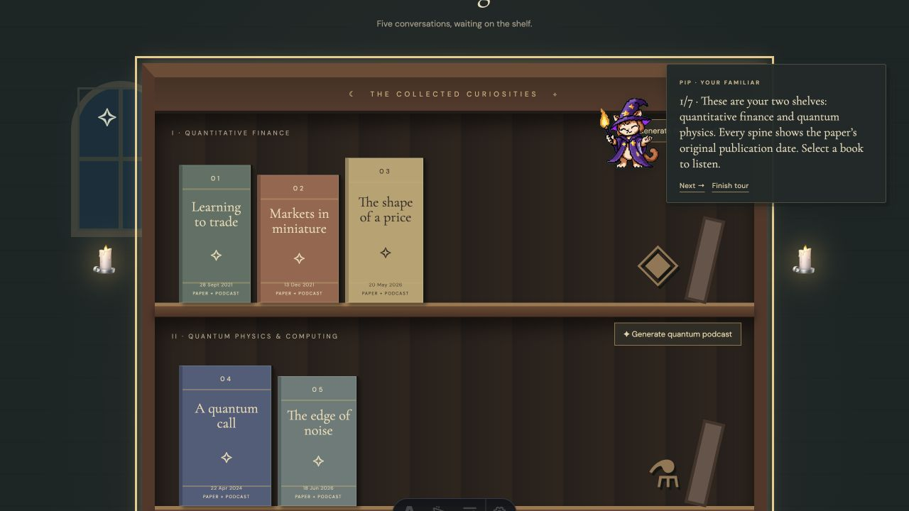
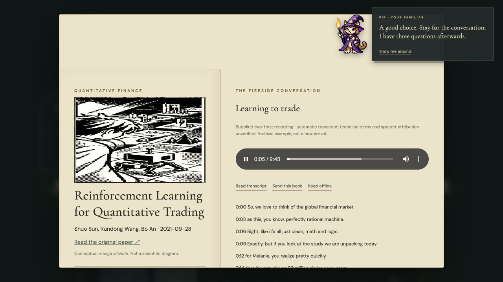
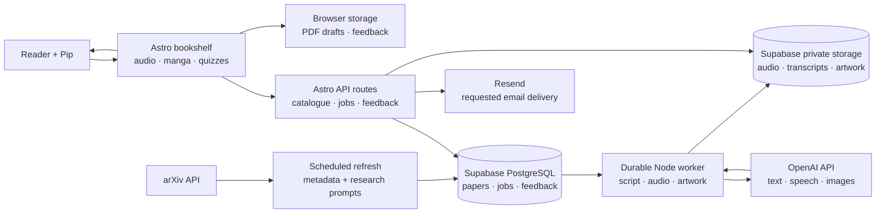

# Alexandria Library

Alexandria Library turns research papers into conversational listening experiences, guided by Pip, your wizard-cat librarian.

We are expected to learn at the speed of AI. Every day brings another paper, another breakthrough, another piece of documentation we are told to read to keep up.

But what happens when reading quickly is not how your mind works? For a dyslexic or neurodivergent learner, the distance between curiosity and comprehension can feel unnecessarily wide. Why should a wall of text be the one-size-fits-all gateway to discovery?

**Alexandria Library** is a listening library for curious minds who want another way in. It brings research into a welcoming bookshelf, with conversational podcasts, transcripts, visual stories and small questions to help ideas stick. The goal is to turn recent arXiv research into engaging audio so your inner scientist can stay connected to discoveries at a pace that works for you.

Pip, your wizard-cat librarian, guides you around the shelf, keeps you company as you listen, and offers questions to help you reflect on what you’ve learned. Your feedback helps the app adapt how it explains ideas. The longer-term vision includes helping you judge a paper’s credibility and relevance.

## A look inside

The reading room and open-book view shown here are from the local development preview.


### Meet Pip, your guide

Select **Show me around** beside Pip to start a seven-step tour of the reading room. Pip points out the shelves and the listening experience, and you can move through the tour with **Next** or finish whenever you like. The tour pictured here is part of the current local development preview.



### From research to conversation

Open a book to see its original paper alongside an audio conversation and timestamped transcript. The example below shows a supplied two-host recording playing with its transcript open; you can read along or follow the link to the paper. Creating a fresh episode uses the optional generation setup described below.



## How it works



The bookshelf brings together source papers, audio conversations, transcripts, conceptual manga and three-question quizzes. Browser storage keeps local PDF drafts and feedback on the device. The app’s Decision endpoint uses saved feedback to suggest an explanation style; scientific credibility assessment is part of the project vision. For fresh research and new episodes, configure the services below: arXiv supplies paper metadata, Supabase stores records and generated assets, and a durable worker coordinates OpenAI text, speech and optional illustration generation. Resend supports email requested by the reader.

## Try it on your computer

You’ll need [Node.js 24](https://nodejs.org/) and Git. Open a terminal and run:

```sh
git clone https://github.com/melaniepreen/alexandria-library.git
cd alexandria-library
npm ci
npm run dev
```

Open the local address printed in the terminal (normally [http://localhost:4321](http://localhost:4321)). Choose a book to explore its paper and transcript. Pip will help you find your way around; a three-question quiz follows each playable sample episode. Your PDF drafts and feedback stay in your browser.

The repository includes the sample book information, artwork and transcripts. The five original audio recordings are personal files, so to listen to those examples, use your copy of the audio archive:

```sh
python3 scripts/restore_audio.py "/path/to/your/Audio overviews-20261101T134113Z-1-001.zip"
```

Replace the path with the location of your ZIP file. Restart the app if it is already running. You can explore the bookshelf and transcripts without the ZIP. The included research catalogue is a dated snapshot; its links lead to the original papers.

To check the project, run `npm test` and `npm run build`.

## Create new episodes and send email

The bookshelf can be explored locally. Generating fresh podcasts, refreshing the catalogue automatically and sending email use optional cloud services and provider accounts. When you are ready to set those up, follow the [cloud setup guide](docs/CLOUD-SETUP.md). This also explains deployment on Vercel and the separate worker that creates episodes.

## How I used Codex

I used Codex as a building partner to turn the initial bookshelf idea into a working prototype. Codex inspected the supplied paper and audio archives, built the interactive library and local draft flow, and helped develop the Astro version with Pip, transcripts, quizzes and feedback. It also used image generation to create the visual assets and recorded the prompts in the [artwork notes](public/art/README.md).

One concrete example: I wanted listeners to answer three questions after an episode. Codex implemented the completion rule so seeking to the end opens the same quiz as listening through, wrote a test for the end-of-playback threshold, and checked the quiz and feedback flow in the browser. Codex also helped document the setup, create the architecture diagram and prepare this public repository.
