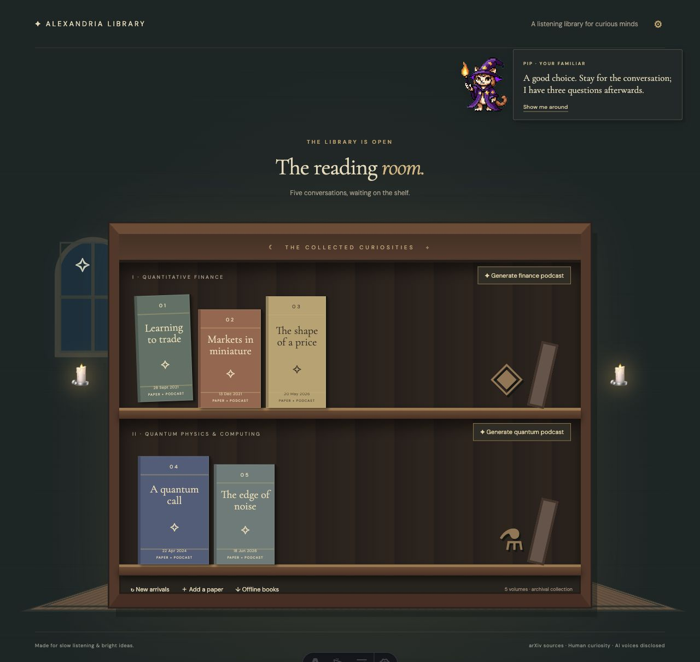
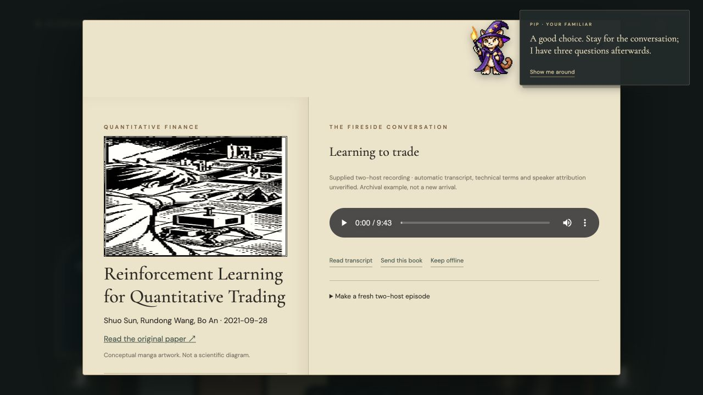
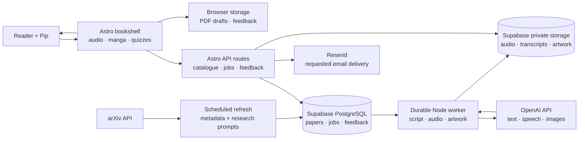

# Alexandria Library

Alexandria Library turns research papers into conversational listening experiences, guided by Pip, your wizard-cat librarian.

We are expected to learn at the speed of AI. Every day brings another paper, another breakthrough, another piece of documentation we are told to read to keep up.

But what happens when reading quickly is not how your mind works? For a dyslexic or neurodivergent learner, the distance between curiosity and comprehension can feel unnecessarily wide. Why should a wall of text be the one-size-fits-all gateway to discovery?

**Alexandria Library** is a listening library for curious minds who want another way in. It brings research into a welcoming bookshelf, with conversational podcasts, transcripts, visual stories and small questions to help ideas stick. The goal is to turn recent arXiv research into engaging audio so your inner scientist can stay connected to discoveries at a pace that works for you.

Pip, your wizard-cat librarian, guides you around the shelf, keeps you company as you listen, and offers questions to help you reflect on what you’ve learned. Your feedback helps the app adapt how it explains ideas. The longer-term vision includes helping you judge a paper’s credibility and relevance.

## A look inside

The reading room and open-book view shown here are from the local development preview.





## How it works



The bookshelf brings together source papers, audio conversations, transcripts, conceptual manga and three-question quizzes. Browser storage keeps local PDF drafts and feedback on the device. The app’s Decision endpoint uses saved feedback to suggest an explanation style; scientific credibility assessment is part of the project vision. For fresh research and new episodes, configure the services below: arXiv supplies paper metadata, Supabase stores records and generated assets, and a durable worker coordinates OpenAI text, speech and optional illustration generation. Resend supports email requested by the reader.

## Run locally

Use Node 24, then install dependencies and start the app:

```sh
npm ci
npm run dev
```

Open [http://localhost:4321](http://localhost:4321). Browse the bookshelf, read transcripts, explore the quizzes and save local drafts and feedback. The five archival sample recordings can be restored from your copy of the supplied audio archive:

```sh
python3 scripts/restore_audio.py "/path/to/Audio overviews-20261101T134113Z-1-001.zip"
```

The sample collection links five finance and quantum papers to existing recordings and locally generated automatic transcripts. Transcript wording and research claims are starting points for exploration; follow the source links to read the original papers. The included arXiv catalogue is a dated snapshot; the refresh service updates it when configured.

Run the project checks with:

```sh
npm test
npm run build
```

## Configure generation and delivery

The cloud setup uses Vercel for the Astro application, Supabase for PostgreSQL and private object storage, a durable Node worker, OpenAI for generation, and Resend for requested emails. Configure only the services you plan to use.

1. Create a Supabase project and run [`supabase.sql`](supabase.sql) in a fresh database. The application tables use row-level security, and the `episodes` storage bucket is private.
2. Copy [`.env.example`](.env.example) to `.env` and set the server-side Supabase and OpenAI values. Generate independent long random values for `OWNER_TOKEN` and `CRON_SECRET`, and set `SITE_URL` to your application URL. Keep `.env` private.
3. Run `npm run seed` to add the five sample paper records. Run `npm run refresh` to retrieve recent finance and quantum metadata and create abstract-grounded finance research prompts when an OpenAI key is configured.
4. Run `npm run worker` on a durable Node host with a process supervisor or scheduler. Each invocation claims one queued job, creates a source-grounded conversational script and AI-voiced audio, validates its duration, and stores the resulting assets. Job status is visible in the app. Set provider spending limits appropriate for your project.
5. Set `IMAGE_MODEL` to an available Images API model, such as `gpt-image-2.5-sunburst`, to generate transcript-grounded cover and comic illustrations. The sample artwork provides a visual starting point.
6. To enable requested email, set `RESEND_API_KEY` and `EMAIL_FROM` using a verified sender or domain. Enter the `OWNER_TOKEN` through the app’s settings to access owner-only cloud actions.

For full-paper generation, paste extracted paper text into **Add a paper**. Generation uses the supplied source text or the arXiv abstract and labels the source scope. The worker validates source references, quiz evidence and audio duration; readers should evaluate the original paper and its scientific claims themselves.

The refresh process uses a three-hour cache and lock, deduplicates arXiv versions, and spaces API requests. An existing worker host can schedule `npm run refresh` every three hours. For Vercel cron, consult the [plan limits](https://vercel.com/docs/cron-jobs/usage-and-pricing) and the optional [`vercel.pro-cron.example.json`](vercel.pro-cron.example.json). Review current [OpenAI pricing](https://developers.openai.com/api/docs/pricing) and your storage, hosting and email costs before enabling paid services.

## Deploy

The project includes an Astro Vercel adapter. Import [the GitHub repository](https://github.com/melaniepreen/alexandria-library) into Vercel, select Node 24, use `npm ci` to install and `npm run build` to build, and add the server environment variables for your selected services. The durable worker runs separately on a Node host. The [project summary](PROJECT.md) describes the audience, today’s build and a concrete example of Codex in the workflow.

## Built with Codex

Codex helped build the listening and quiz experience, including the completion rule that opens the same three-question quiz when a listener seeks to the end. The repository includes tests for that rule alongside catalogue, feedback and sample-data checks. Artwork prompts and provenance are documented in [`public/art/README.md`](public/art/README.md).
